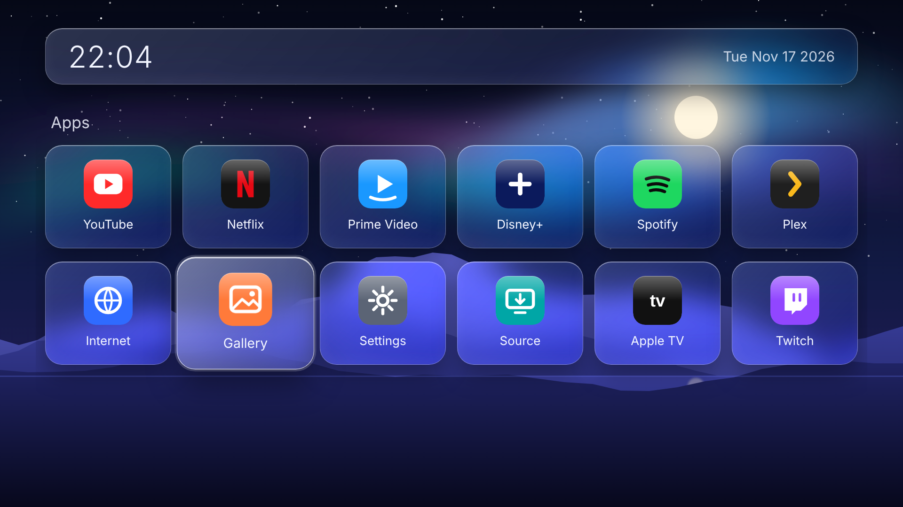

# Glass Home: a liquid-glass launcher for Samsung Tizen TVs

A lightweight home screen for a Samsung UA50KU7000K (2016, Tizen 2.4). It has no frameworks, no images to download and no network calls. It reads the apps installed on the TV and lets you launch them with the remote's arrow keys and Enter.

> **What this is not:** a replacement OS. Samsung firmware is signed, so this is an app that runs *on top of* Tizen.
> Real glass blur (`backdrop-filter`) is used only if the TV's browser engine supports it. A 2016 engine likely doesn't (not verified), so it falls back to a translucent gradient glass.

## Install (sideload)
1. Install **Tizen Studio** with the *TV Extensions* and the *Samsung Certificate Extension*.
2. On the TV: open **Apps**, then press `1 2 3 4 5` on the remote. Turn **Developer mode** on and enter your PC's IP. Then restart the TV.
3. In Tizen Studio, open **Device Manager**, add the TV by its IP, and connect.
4. Create a Samsung certificate in **Certificate Manager**.
5. **File → Import → Tizen → Tizen Project**, pick this folder, then right-click the project → **Run As → Tizen Web Application**.

## Customise
- **Wallpaper:** put a `wallpaper.jpg` (1920×1080) in this folder and it replaces the built-in night-sky `wallpaper.svg`.
- **Icons:** on the TV, real app icons come from the system. `icons.js` has generic fallback glyphs for when an app reports none.

## Remote
Arrows: move · Enter: launch · Back: hide

## Preview in a browser
Open `index.html` in a browser. It shows demo apps when the Tizen API isn't available.
